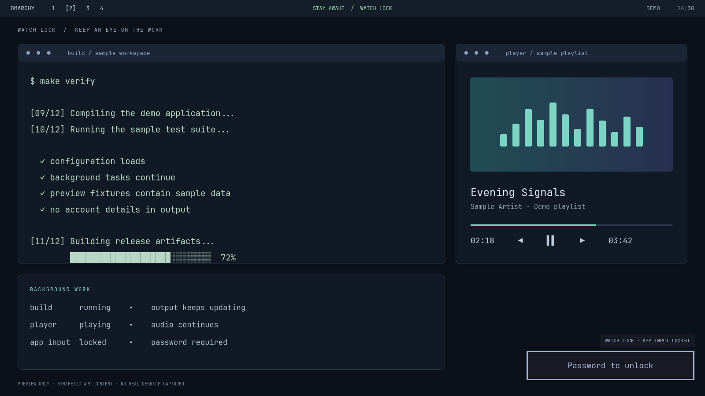
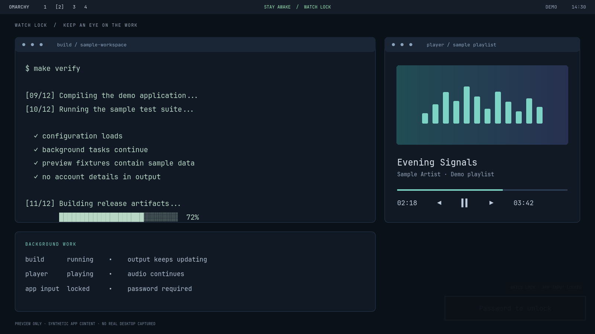

# Watch Lock for Omarchy

**Watch your apps work. Keep hands off the keyboard.**

A real Wayland session lock that keeps your current workspaces visible and
updating. Follow a build, watch an agent finish a task, or keep a player in view
while keyboard, pointer and touch input belongs to the lock surface.

By **Daniel Moya** · [@danimoya](https://github.com/danimoya) · me@danimoya.com

**Development preview · 0.1.0-dev.** This is an independently maintained Omarchy
lock-service mod, not an official widget or an audited security release.
See [validation](VALIDATION.md) and [remaining release checks](RELEASE-CHECKLIST.md).



## What it does

- **Stay Awake on:** manual locking keeps live apps visible, with a compact
  password field in the bottom-right corner.
- **Stay Awake off:** normal password locking. A compatible animated-screensaver
  companion can request an animation behind the locked session at its idle deadline.
- The password panel is **95% transparent off-panel**, and becomes fully visible
  on hover. Keyboard entry still works when faded; Esc clears the input.
- Uses the existing system password and enrolled fingerprint through Omarchy PAM.
  No new credential, cloud account, or unlock-by-IPC path.
- An already opaque lock cannot be made transparent by enabling Stay Awake or
  calling the watch IPC method. Sleep/system-lock requests hide a watch desktop.
- Live screensavers require all active outputs to have visible fullscreen
  screensaver windows, an open lid, and AC power or battery above 50%.
- Existing media and hardware shortcuts retain the compositor's normal behavior.



These are actual renders of the repository's QML password panel over an invented
desktop fixture. **No real desktop, account, repository, terminal history or
credential was captured.** They are preview images, not proof of a secure lock.
Reproduce them with `python3 preview/render.py`.

## Requirements

Omarchy 4.5 / Hyprland 0.56 with Quickshell, Python 3, Bash, procps-ng, util-linux,
and the normal `/etc/pam.d/omarchy-lock-password` configuration. Fingerprint
support uses existing Omarchy enrollment. Wallpaper video posters use the
packaged Omarchy helper. The optional animated companion is separate:
[Animated Screensavers](https://github.com/danimoya/omarchy-animated-screensaver).
Use a companion revision with the `idleScreensaver` hook; older revisions skip
starting animations after a manual lock.

## Setup

Review the source and keep a working password/recovery session. This replaces
the lock service; enable **one** lock provider at a time. Installing source does
not establish that the release checks have passed on your machine.

```sh
omarchy plugin add https://github.com/danimoya/omarchy-watch-lock.git
```

Leave it disabled until configuration is ready. With the plugin installed at
`~/.config/omarchy/plugins/danimoya.watch-lock`:

```sh
omarchy plugin validate ~/.config/omarchy/plugins/danimoya.watch-lock
mkdir -p ~/.local/bin
# Only create this link when the destination is unused; preserve existing tools.
ln -s ~/.config/omarchy/plugins/danimoya.watch-lock/scripts/omarchy-watch-lock ~/.local/bin/omarchy-watch-lock
```

Add this to your **user** Hyprland Lua configuration, preserving the prior values:

```lua
hl.config({ misc = { session_lock_xray = true, session_lock_blur = false } })
```

In `~/.config/hypr/bindings.lua`, replace the standard manual lock binding:

```lua
-- Was: the normal system-lock command.
o.rebind("SUPER + CTRL + L", "Watch Lock (follows Stay Awake)", "omarchy-watch-lock")
```

Run `hyprctl reload` then `hyprctl configerrors`. Unlock before enabling the
plugin through Omarchy, replacing the previous lock provider, or restarting the
shell. Restart while unlocked with `omarchy restart shell`; check that
`omarchy-watch-lock --status` reports `watchLockInstalled: true` and
`passwordPam: true`. Do not modify PAM or overwrite existing authentication files.

The existing **Stay Awake** widget selects the mode. It does not itself lock the
session. Use **Super+Ctrl+L** or `omarchy-watch-lock` to lock after selecting it.
Stay Awake disables automatic idle locking; when off, your configured idle
screensaver and lock timers remain in effect.

## Commands

| Command | Behavior |
| --- | --- |
| `omarchy-watch-lock` | Lock using the mode selected by Stay Awake |
| `omarchy-watch-lock --status` | Read lock/coverage state, without credentials |
| `omarchy-watch-lock --preview` | Visual preview only; click to dismiss |
| `omarchy system lock` | Ordinary opaque lock, including sleep/lid paths |

Unknown live-render support or unavailable watch IPC falls back to normal lock.
The CLI waits for compositor acknowledgement before reporting a confirmed lock.

## Visibility and validation limits

Watch mode deliberately exposes everything visible on your workspaces to people
near the screen. Use ordinary locking when the contents need privacy. Terminal
screensavers and compositor transparency need special care on window failure,
monitor changes and recovery; these remain release gates. The coverage poll
is a guard, not a claim of audited, frame-perfect isolation.

This fresh repository contains only the standalone password-based implementation.
It does not alter the maintainer's running desktop or publish another lock
product's code, assets or history.

## Removal

Unlock first. Disable/remove `danimoya.watch-lock` using Omarchy and restore the
previous lock provider. Confirm `omarchy-shell lock status` reports password PAM
ready. Remove the CLI link only if it points to this plugin. Restore the recorded
Hyprland rendering values and manual lock binding; reload and check config errors.
Enrollment, password/PAM files, idle preferences and other plugins are not removed.

## Development

```sh
python3 -m unittest discover -s tests -v
node --test tests/policy.mjs
omarchy plugin validate .
bash -n scripts/omarchy-watch-lock
```

MIT source; see [LICENSE](LICENSE) and [upstream attribution](NOTICE.md).
Issues and contributions: https://github.com/danimoya/omarchy-watch-lock/issues.
